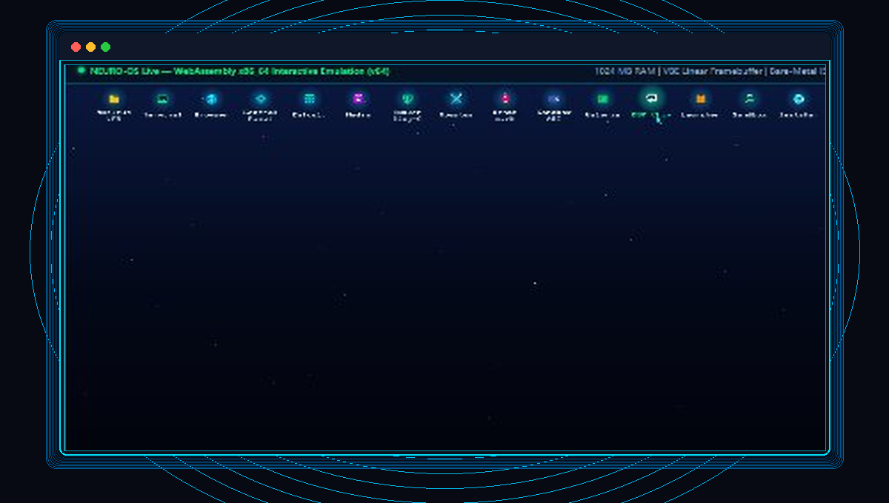

# 🧠 NEURO-OS Genesis — Pre-Alpha Live Demo (`x86_64` Bare-Metal)

<div align="center">

[](https://cyberenigma-lgtm.github.io/neuro-os-live-demo/)

### 🚀 [▶ HAZ CLIC AQUÍ PARA PROBAR LA DEMO EN VIVO / CLICK HERE TO PLAY LIVE DEMO](https://cyberenigma-lgtm.github.io/neuro-os-live-demo/)

[](https://cyberenigma-lgtm.github.io/neuro-os-live-demo/)
[](https://cyberenigma-lgtm.github.io/neuro-os-live-demo/)
[](https://cyberenigma-lgtm.github.io/neuro-os-live-demo/)
[](https://github.com/cyberenigma-lgtm/neuro-os-live-demo/issues)
[](https://github.com/cyberenigma-lgtm/neuroweb-boot)
[](https://www.safecreative.org/work/2611247743117)

*Arranque real en Long Mode x86_64 dentro de tu navegador web mediante emulación WebAssembly de alto rendimiento.*

[🇬🇧 English](#english) | [🇪🇸 Español](#español)

</div>

---

<a name="español"></a>
## 🇪🇸 Español

> ⚠️ **Estado del proyecto: Fase Muy Temprana (Pre-Alpha / Desarrollo Activo)**  
> Este repositorio aloja **únicamente una compilación de demostración en vivo** para pruebas directas desde el navegador. El sistema operativo está en una fase inicial de investigación y desarrollo, faltan muchas funciones y se actualiza periódicamente. El código fuente permanece cerrado y propietario.

### 🖥️ ¿Qué verás al abrir la demo interactiva?
Al hacer clic en el enlace de la demo ([https://cyberenigma-lgtm.github.io/neuro-os-live-demo/](https://cyberenigma-lgtm.github.io/neuro-os-live-demo/)), el emulador WebAssembly cargará y ejecutará la imagen ISO real (`~14.6 MB`) mostrando:
1. **Dock Superior Soberano (GXHTML):** Barra de iconos interactiva con efectos de halo neón y lanzadores integrados.
2. **Motor Gráfico DVTRGAS-30 & Quartz Compositor:** Renderizado acelerado por software en búfer lineal VBE (`1280x720@32bpp`).
3. **Fondo Cósmico Dinámico:** Starfield animado generado directamente por el kernel bare-metal.
4. **Barra de Tareas Soberana (Workstation Taskbar):** Botón del sistema `[NEURO-OS]`, selector de escritorios `[1]..[6]`, reloj y control central.
5. **Consola Serie en Vivo (COM1):** Panel de depuración que retransmite en tiempo real el registro del kernel (Caja Negra Ring-0, autodetección AHCI/NVMe, subsistema de syscalls MSR LSTAR y ciclo de fotogramas).

---

### ⚙️ ¿Qué es NEURO-OS?
**NEURO-OS** es un sistema operativo experimental *bare-metal* de 64 bits (`x86_64`) escrito desde cero (~515 KB de kernel en disco) que investiga una arquitectura de **cápsulas ligeras multi-ABI** (Windows PE64, Linux ELF64, Android DEX y macOS Mach-O) ejecutándose directamente sobre hardware sin máquinas virtuales pesadas.

### 🚀 Ejecución Nativa en QEMU / KVM
Si deseas ejecutar la ISO directamente en tu máquina con aceleración por hardware:
```bash
qemu-system-x86_64 -cdrom Neuro-OS-Live-Demo.iso -m 1024M -vga std
```

### 🤝 ¿Quieres colaborar o probarlo?
Este es un proyecto independiente en constante evolución. Si te apasiona el desarrollo de sistemas operativos, cargadores binarios (`ELF`/`PE`), drivers de hardware o motores gráficos vectoriales:
- **Prueba la demo en vivo:** [https://cyberenigma-lgtm.github.io/neuro-os-live-demo/](https://cyberenigma-lgtm.github.io/neuro-os-live-demo/)
- **Abre un Issue:** Comparte tus sugerencias, reporta incidencias o propón colaboraciones.

*Todos los derechos reservados — Arquitectura y desarrollo por **JMMC** (Noxferion).*

---

<a name="english"></a>
## 🇬🇧 English

> ⚠️ **Project Status: Very Early Stage (Pre-Alpha / Active Development)**  
> This repository hosts **only a compiled live demo build** for browser-based testing. The operating system is in an early research & development phase, lacks many features, and is updated regularly. Source code remains proprietary.

### 🖥️ What to expect in the Live Demo
When launching the interactive demo ([https://cyberenigma-lgtm.github.io/neuro-os-live-demo/](https://cyberenigma-lgtm.github.io/neuro-os-live-demo/)), the WebAssembly engine boots the real bare-metal ISO (`~14.6 MB`), presenting:
1. **Sovereign Top Dock (GXHTML):** Neon-halo application launcher dock rendered natively.
2. **DVTRGAS-30 Vector Graphics & Quartz Compositor:** Software compositor blitting directly into the VBE Linear Framebuffer (`1280x720@32bpp`).
3. **Cosmos Starfield Canvas:** Dynamic nebula starfield rendered directly by the 64-bit kernel.
4. **Workstation Taskbar:** System menu `[NEURO-OS]`, workspace switchers `[1]..[6]`, clock, and control panel.
5. **Live Kernel Serial Console (COM1):** Real-time diagnostic stream displaying Ring-0 telemetry, AHCI/NVMe bus probes, MSR LSTAR syscall init, and compositor loop metrics.

---

### ⚙️ What is NEURO-OS?
**NEURO-OS** is an experimental 64-bit (`x86_64`) *bare-metal* kernel written from scratch (~515 KB kernel on disk) exploring a lightweight **multi-ABI capsule architecture** (Windows PE64, Linux ELF64, Android DEX, and macOS Mach-O) running directly on raw silicon without heavy hypervisors.

### 🚀 Run the Real ISO Natively (QEMU / KVM)
You can also run the bootable ISO locally with hardware virtualization:
```bash
qemu-system-x86_64 -cdrom Neuro-OS-Live-Demo.iso -m 1024M -vga std
```

### 🤝 Feedback & Collaboration
- **Launch Browser Demo:** [https://cyberenigma-lgtm.github.io/neuro-os-live-demo/](https://cyberenigma-lgtm.github.io/neuro-os-live-demo/)
- **Submit Feedback:** Open an issue to share bug reports or ideas.

*All rights reserved — Architecture & development by **JMMC** (Noxferion).*

---

### ⚖️ Transparencia Legal y Atribución / Legal Attribution
- **NEURO-OS Kernel & ISO Image:** © Propiedad Intelectual y Marca Registrada *"NeuroOs Genesis"* por **José Manuel Moreno Cano (Noxferion)**. Sello: `0x4A4D4D43`.
- **NeuroWeb-Boot Engine (MMIO LFB, Throttling & SDK):** Registrado en **Safe Creative ID: [`2611247743117`](https://www.safecreative.org/work/2611247743117)**. Motor en: [`cyberenigma-lgtm/neuroweb-boot`](https://github.com/cyberenigma-lgtm/neuroweb-boot).
- **Componentes Base de Virtualización:** Emulador Wasm base bajo licencia **BSD 2-Clause** (© Fabian Hemmer) y SeaBIOS bajo **GNU LGPLv3**.
